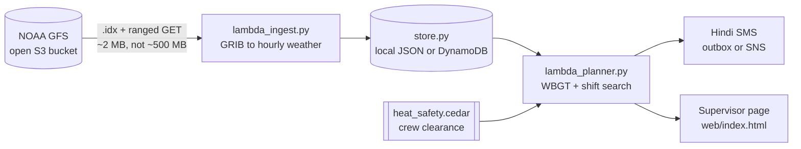

# Shadecast

**Move the work, not the worker.**

Heat-aware shift planning for outdoor work crews in India. Shadecast doesn't tell a crew to stop working. It tells them which hours cost the least, and sends every worker the plan as a Hindi SMS.

Built by **team CryptiX** for Environmental Hacks, Bharat Builds Tour 2026 (Track: Heat and Water, Bhopal).

---

## The problem

Heat costs Indian workers about **$78 billion a year in lost wages, roughly 2% of GDP**. Construction and road workers lose around 24 days of work a year to it, close to a tenth of their annual earnings. About **30% of that loss is recoverable** just by moving work out of the hottest hours.

India's Heat Action Plans trigger on **air temperature alone**. A Centre for Policy Research review of 37 of them found only 10 set locally defined thresholds, and none account for humidity. In the ISO 7243 heat-stress standard, air temperature is the *least*-weighted of the three inputs.

```
$ python3 run_demo.py --compare

Bhopal, dry pre-monsoon day (mid May)      peak air 42.0 C    peak WBGT 30.0 C
Bhopal, monsoon-break day (late July)      peak air 31.5 C    peak WBGT 30.1 C
```

The July day is 10.5 °C cooler and puts the same strain on a working body. No heat warning fires on it anywhere in India.

## What Shadecast does

1. **Pulls the hourly forecast** for a worksite from NOAA GFS, published as open data in S3.
2. **Estimates Wet Bulb Globe Temperature (WBGT)**, the index ISO 7243 and the ACGIH work-rest limits are written against. It accounts for humidity, radiant sun and wind.
3. **Searches every legal shift placement**, including split shifts, and picks the one that delivers the required work with the least severe exposure.
4. **Applies crew-level rules** with a Cedar policy: who may be assigned to which heat band.
5. **Sends the plan**: a shift sheet for the supervisor and a **Hindi SMS** for every worker, readable on a ₹1,000 feature phone. No app, no data connection.

```
TODAY'S SHIFT   05:00-11:00  +  17:00-20:00

 >05:00   23.4  28.0   55%  ###  safe      continuous
 >08:00   27.5  32.6   43%  ##   caution   45 min / 15 min
  13:00   30.0  41.0   20%  !    severe    15 min / 45 min
 >17:00   29.3  41.0   20%  #    high      30 min / 30 min

  Productive hours   2.8  ->  6.2   (+3.5)
  Severe-risk hours  removed: 5
  Wages protected    approx Rs 2,362 for the crew (estimate)
```

### The constraint that changed the product

Our first optimiser recommended 05:00 to 11:00 plus 17:00 to 20:00: 6.2 productive hours and zero severe exposure. It also meant **fifteen hours on site for nine hours of work**, with a gap too short to go home. The crew would sit at the site in the heat we'd just told them to avoid.

So the optimiser now scores the worker's whole day, not just their exposure. When neither plan clearly wins, Shadecast shows both and what each costs, because the right one depends on where the crew sleeps and no weather model knows that.

## Architecture



| Piece | Run locally (Build It) | Deployed (Ship It, in repo, not deployed) |
|---|---|---|
| Forecast data | `s3://noaa-gfs-bdp-pds`, anonymous | same bucket |
| GRIB ingest | `aws/lambda_ingest.py` | Lambda (container image) + EventBridge |
| WBGT + shift search | `aws/lambda_planner.py` | Lambda (zip) |
| Sites, forecasts, plans | JSON in `.shadecast-data/` | DynamoDB (7-day TTL on forecasts) |
| Message to the crew | `.shadecast-data/outbox.txt` | SNS to SMS |
| Supervisor page | `web/index.html` | S3 static site + API Gateway |

The two Lambda handlers never import `boto3` directly. They ask `shadecast/store.py` for a table, and one environment variable (`SHADECAST_BACKEND`) switches between local JSON and DynamoDB. The function you run on a laptop is the same function that would run in Lambda.

The planner has **no hard dependencies** (standard library only). Reading GRIB2 needs the native ecCodes library, so ingest is its own function and the one that must never fail has nothing in it to break.

## How we use AWS

We took the **Build It** path: the whole system runs with AWS open-source tools and open data, with no AWS account. The deploy path is written but **not deployed**.

- **NOAA GFS in the Registry of Open Data on AWS** (`s3://noaa-gfs-bdp-pds`, CC0), read anonymously. Every GFS file has a sibling `.idx` listing byte offsets, so we do ranged GETs for the five fields we need.
- **Cedar**, AWS's open-source policy language, holds the labour-safety rules in [`shadecast/policies/heat_safety.cedar`](shadecast/policies/heat_safety.cedar). Unacclimatised workers, workers under 18, workers over 55 and workers with a heat-aggravated condition are held out of the bands they shouldn't be in. A safety officer can read the file and an inspector can audit it.
- **AWS SAM**: [`aws/template.yaml`](aws/template.yaml) defines the Lambda functions, DynamoDB tables, SNS topic and schedule, with sample events in `events/` for `sam local invoke`.
- **AWS Lambda handler code**, run locally unchanged.

## Two optimisers, held identical

The supervisor page recomputes the plan as you drag a slider, so the shift search runs in the browser as well as in Lambda. [`tests/test_js_parity.py`](tests/test_js_parity.py) runs `web/optimiser.js` under Node against the Python optimiser across every combination of day, workload, acclimatisation, required hours and span limit (270 cases) and asserts the plans are identical. The physics runs once, in Python, and the hourly result is passed to the browser.

## The model, and what is wrong with it

`WBGT = 0.7·Tnwb + 0.2·Tg + 0.1·Ta`

| Term | Method | Source |
|---|---|---|
| Wet bulb | Stull (2011), ±0.3 °C | J. Applied Meteorology and Climatology |
| Black globe | Linearised solution, wind and solar radiation | [NWS Tulsa WBGT paper](https://www.weather.gov/media/tsa/pdf/WBGTpaper2.pdf) |
| Work-rest ratios | ACGIH TLVs, acclimatised, normal clothing | ISO 7243 |

**Known limitations** (stated on the page and in the demo video):

- **Not validated against a physical globe thermometer.** We estimate WBGT from the forecast. In strong sun the psychrometric wet bulb runs slightly low versus the natural wet bulb, which is mildly non-conservative. A ₹2,000 globe thermometer on one pilot site would calibrate it.
- The GFS grid is about 28 km, so differences between asphalt and tree cover within a city aren't resolved.
- ACGIH TLVs assume healthy acclimatised adults. They aren't calibrated for pregnancy, cardiac or kidney conditions.
- "Wages protected" is an estimate: rescued productive hours priced at the day rate.
- Demo days are generated climatological profiles for Bhopal, not measurements, and the UI labels them. `scripts/fetch_real_days.py` pulls observed GFS days and relabels them "observed".

## Quick start

```bash
pip install -r requirements.txt
```

**The whole pipeline, no AWS account:**

```bash
python3 scripts/run_pipeline.py --offline   # stored day, no network
python3 scripts/run_pipeline.py             # live NOAA GFS from S3
```

This registers a site, then runs the ingest handler, the planner handler and the API handler in order.

**The engine on its own:**

```bash
python3 run_demo.py --compare                          # dry vs humid headline
python3 run_demo.py --workload heavy --unacclimatised
```

**The supervisor page:**

```bash
python3 build_scenarios.py && open web/index.html
```

**Tests:**

```bash
python3 -m pytest        # 325 tests
```

Covers the engine against published psychrometric values, the ACGIH table, the span constraint against the exact fifteen-hour plan that started it, Cedar denying rather than failing open, and the 270 browser/Python parity cases. The suite has been mutation-checked: disabling the span constraint or altering the JS search makes it fail.

**With SAM CLI (needs Docker):**

```bash
sam build --template aws/template.yaml
sam local invoke PlannerFunction --event events/scheduled.json
```

## Deploy (optional)

Nothing above needs an AWS account. To run the same handlers on AWS:

```bash
sam build --template aws/template.yaml
sam deploy --guided --stack-name shadecast --capabilities CAPABILITY_IAM
python3 scripts/seed_site.py
```

Tear down with `sam delete --stack-name shadecast`.

## Repository layout

```
shadecast/wbgt.py          WBGT estimation + ACGIH thresholds   (stdlib only)
shadecast/schedule.py      the shift optimiser                   (stdlib only)
shadecast/report.py        shift sheet, Hindi SMS, JSON          (stdlib only)
shadecast/forecast.py      NOAA GFS from S3 + offline profiles
shadecast/store.py         storage: local JSON or DynamoDB
shadecast/policy.py        Cedar crew clearance
shadecast/policies/        the heat-safety policy, as readable Cedar
aws/lambda_ingest.py       GRIB ingest handler
aws/lambda_planner.py      EventBridge + API Gateway handler
aws/template.yaml          the SAM stack
events/                    sample events for sam local invoke
scripts/                   run_pipeline, fetch_real_days, seed_site
web/                       supervisor page, architecture figure, browser optimiser
tests/                     325 tests, mutation-checked
SECURITY.md                threat model, and what this build does not do
```

## Data and licences

NOAA GFS via the Registry of Open Data on AWS, CC0. NOAA requests attribution and does not endorse this project.

## Team

**Team CryptiX**

- **Kunal Jha**: backend, forecast ingest, WBGT engine, shift optimiser, Lambda handlers, Cedar policy, tests
- **[Teammate name]**: design and demo video

Demo video: [add YouTube link]
